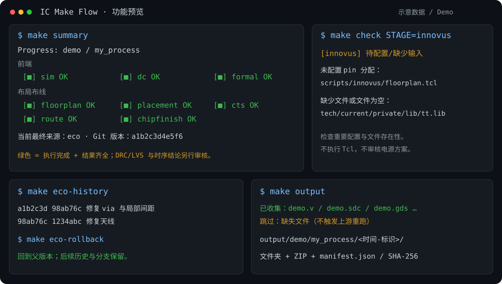

> 配合AI食用效果更佳

# IC Make Flow

面向数字 IC 模块实现与学习的 Make / Python / Tcl 流程框架。用统一 Make 入口串起 RTL 仿真、综合、等价验证、布局布线、手工 ECO、物理验证和交付打包；一个工程维护一套当前工艺，阶段脚本集中、可直接修改。

## 为什么使用

- **看得见的进度**：`make summary` 按细分阶段显示完成、失败、运行中及未完成状态，同时保留时序和几何 DRC 提示。绿色表示执行成功且结果齐全，不代替签核。
- **简洁的准备检查**：`make check` 检查重要名称、文件列表、库文件、形状和 pin 配置。整个 Innovus 合并检查；不要求人工审核声明，不解析 Tcl 正确性，不限制电源拓扑。
- **可以回退的手工 ECO**：每版同时保留 finish 前的 editable 与 finish 后的结果。独立 Git 版本库支持备注、历史、父版本回退、指定版本切换和分支保留。
- **清楚的职责**：Make 管依赖，Python 管输入/状态/归档，Tcl 管工具实现；DC、Formality、PT 和各 Innovus 阶段有明确编辑入口。
- **报告集中查看**：按阶段、corner、ECO 版本归集，自动解压报告，保留来源信息与原始压缩文件，不触碰 Innovus 数据库内部压缩文件。
- **交付无需重跑**：`make output` 无依赖，只收集当前最终版本已存在文件，缺项跳过，生成文件夹、ZIP 与含 SHA-256 的清单。
- **选择性重跑**：`FORCE_STAGE` 指定重跑阶段；普通编辑或 touch 不会自动将完整结果标为过期。显式重跑和版本切换会使相关下游待更新。

## 效果展示



> 上图是终端风格的功能示意，名称、版本与状态均为示意数据，不是真实设计截图或签核证明。

- `summary` 一眼查看细分阶段进度，同时展示当前最终版本和未解决问题。
- `check` 集中提示重要配置/库缺项，避免逐条审核声明和大量参数噪声。
- ECO 在 `editable → finish → final` 间保存成套数据，回退按父版本，不丢弃其它分支。
- `output` 独立打包当前已存在交付物，文件夹与 ZIP 同时生成，缺项写入清单。

版本关系示意（可回退后继续形成分支）：


## 环境和适用范围

实际流程需要 Linux、GNU Make、Bash、Python 3、Git，以及合法可用的 VCS / Verdi、Design Compiler、Formality、Innovus、Calibre、StarRC、PrimeTime。只运行框架测试不需要 EDA，部分测试需要 Git/Tcl。Python 实现使用标准库；CI 配置覆盖 Python 3.9 和 3.12，但本次公开整理尚未执行该 CI。

框架曾在单一实际项目中完成模块级流程验证，工具入口主要沿用 Innovus 18.10、Calibre 2019、Synopsys 2018 一类环境。公开版移除了所有工艺库、Calibre 规则、供应商模型、真实报告和项目源码；自带 Tcl 中的 GF180 单元/层名是需适配的参考设置。其它工具版本与工艺需要自行调整。

## 快速开始

```bash
make help
make test
# 编辑 config.mk、filelist、scripts 与 tech/current 的配置后：
make check
make sim
make dc
make formal
make postsim
make chipfinish GUI=0
```

空白模板初始 `check` 不通过是预期行为。若只想先体验 RTL 仿真，可备份自己的 config 后将 `examples/counter/config.mk` 复制到根目录，再执行 `make sim`；该自写 counter 示例不含完成的综合约束或物理方案。

## 文档

- [目录与逐文件用途](docs/structure.md)：配置、脚本、内部模块、测试、示例和生成目录。
- [全部 Make 命令与参数](docs/commands.md)：包括 STAGE、FORCE_STAGE、GUI、REV、输出与清理语义。
- [典型完整流程（含 ECO）](docs/workflow.md)：从配置到签核、ECO、回退与交付。
- [工艺接入说明](tech/current/README.md)：库路径、corner、规则入口和私有资料管理。
- [贡献说明](CONTRIBUTING.md)、[变更记录](CHANGELOG.md)、[发布准备记录](docs/release.md)、[发布内容检查记录](docs/publication-audit.md)。

## 目录概览

```text
config.mk             设计名称、时钟、文件列表和主要参数
Makefile              用户目标与依赖
scripts/              可修改的工具脚本；Innovus 每阶段一个文件
flow/                 Python 调度/检查/报告/版本，以及内部 Tcl 辅助
tech/current/         当前唯一工艺配置；不含 PDK，private/ 默认忽略
rtl/、tb/             用户 filelist 与源码放置入口
examples/counter/     自写最小 RTL 仿真示例
tests/               不启动 EDA 的框架回归
docs/                使用说明
```

详细目录树见 [structure.md](docs/structure.md)。

## 常用后续操作

```bash
make drc                    # 准备版图并打开 GUI；在 GUI 内实际运行 DRC
make lvs                    # 准备源/版图/hcell 并打开 GUI，加载生成的 lvs.runset
make pt                     # 当前最终版的寄生提取与各 corner STA
make eco                    # 打开当前版本的 finish 前数据库
# Innovus 中：eco_export {修复说明}，然后退出
make eco-accept             # 核验导出，自动 Git 提交并切换当前版
make eco-history
make eco-rollback            # 回到当前版的父版本
make reports
make postverdi_sdf
make output                 # 不触发上游；文件夹与 ZIP 位于 output/
```

**清理语义**：不带 STAGE 的 `make clean` 会删除当前设计/工艺的全部工作结果、ECO Git 历史和报告。`output/` 的独立交付包保留。先使用 `make clean-preview` 查看范围。

## 许可证与发布边界

框架代码和自写示例使用 [MIT License](LICENSE)。许可证不授予任何 EDA 软件、PDK、标准单元库或 foundry 规则的使用与再分发权。本仓库不包含这些资料。请只将本项目目录作为 Git 仓库根目录，不要把外部迁移备份或私人工作区一起上传。